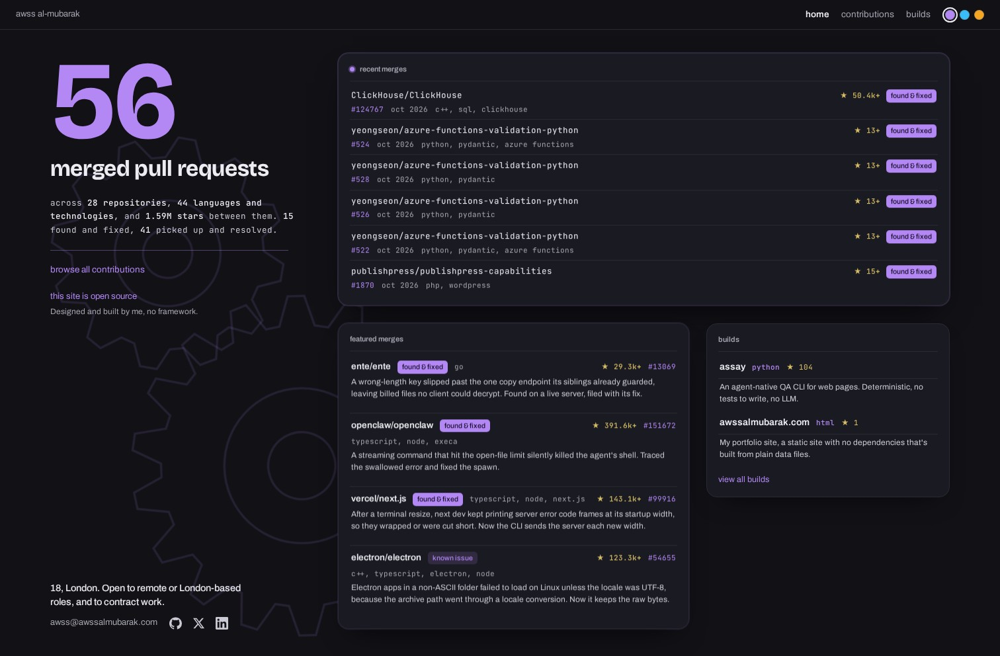
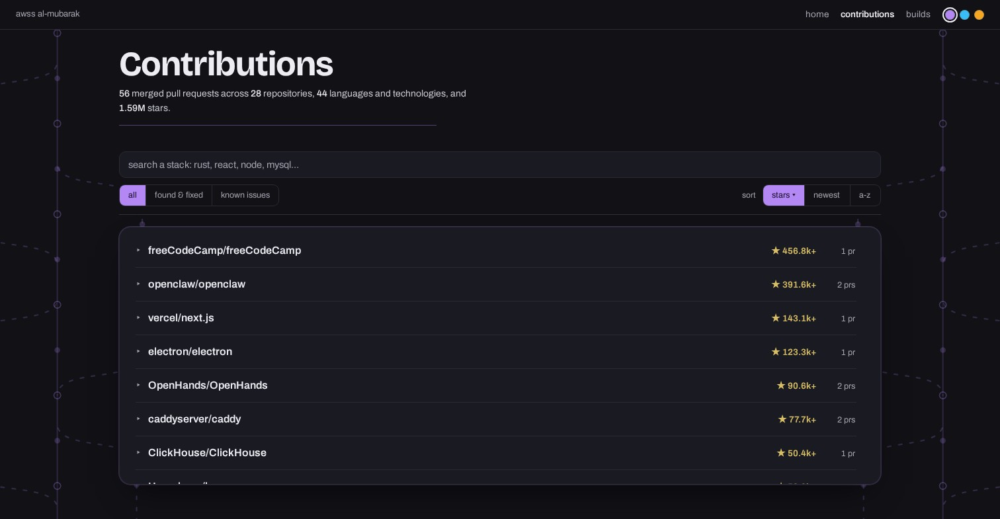
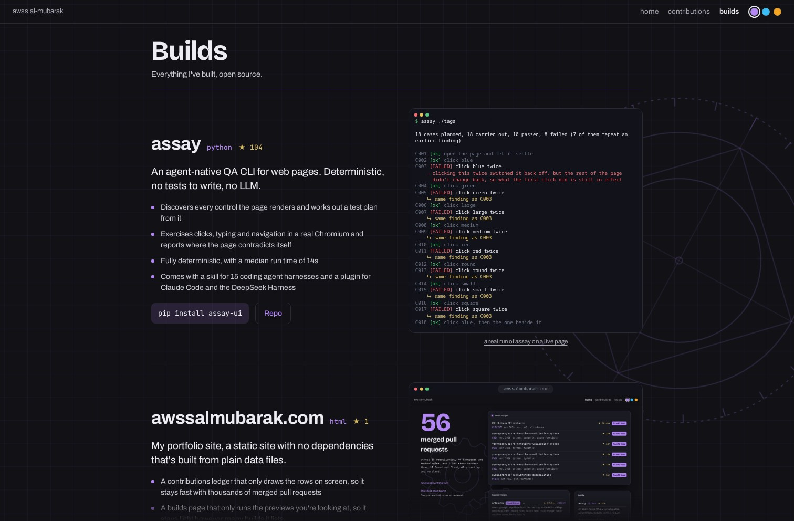
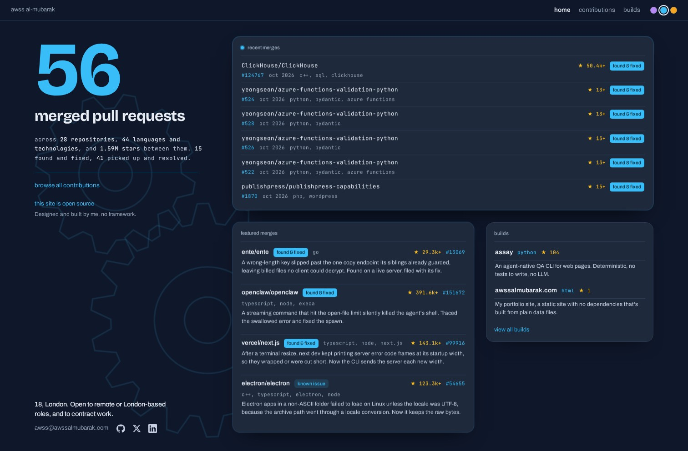
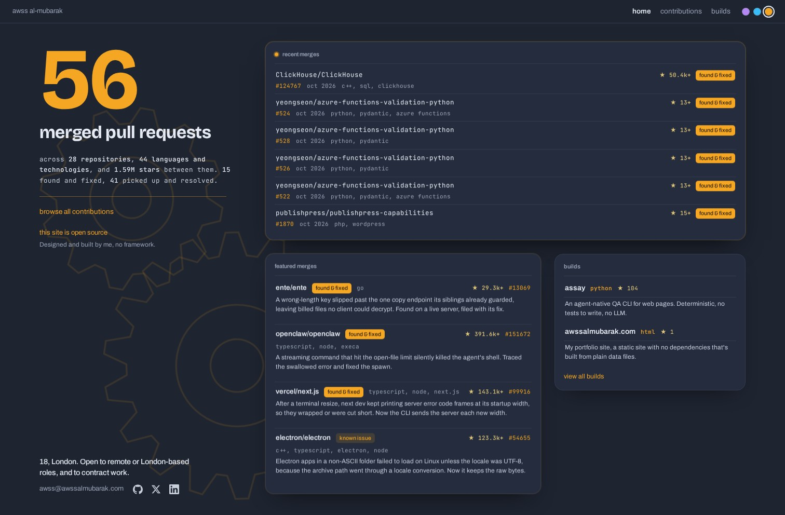

<!-- i18n-source: README.md 61b2a7a54cb57bd7d47644ec1f2649f925183dc6 -->

<p align="center">
  
</p>

<h1 align="center">awssalmubarak.com</h1>

<p align="center"><a href="README.md">English</a> · <b>简体中文</b> · <a href="README.ja.md">日本語</a> · <a href="README.ko.md">한국어</a> · <a href="README.ru.md">Русский</a></p>

<p align="center">
  <a href="LICENSE"></a>
  <a href="https://awssalmubarak.com"></a>
</p>

<p align="center">
  <a href="#the-virtualized-ledger">贡献记录</a> · <a href="#the-builds-page">作品页面</a> · <a href="#how-it-works">工作原理</a> · <a href="#run-it">运行</a> · <a href="#tests">测试</a> · <a href="#layout">目录结构</a> · <a href="#license">许可证</a>
</p>

---

<p align="center">
  
</p>

---

这是我个人网站的源码。它是一个静态网站（static site），没有运行时依赖，也没有使用框架，由一条只用 Python 标准库写成的小型流水线（pipeline）生成。无论贡献页面列出的是二十个还是两万个已合并的 pull request（merged pull request），页面都能保持流畅。无论作品（builds）页面列出多少个作品，它都只运行你正在看的那些预览。

---

## <a id="the-virtualized-ledger"></a>虚拟化的贡献记录

贡献页面记录了我所有已合并的 pull request。按照我预期达到的规模，这会有数万行，所以我用原生 JavaScript 手写了一个虚拟列表（virtualized list）。只有视口（viewport）附近的行才会出现在 DOM 中，一个仓库的 pull request 只有在你展开它时才会生成，搜索经过防抖（debounce）处理，只筛选数据，而不是每次按键都重建页面。

下面是这样做的收益，对比对象是一次性渲染所有行的版本，数据为 2,500 个仓库和 13,724 个已合并的 pull request：

| | 朴素实现（全部渲染） | 虚拟列表（本站） |
|---|---|---|
| DOM 节点 | 127,306 | 281 |
| 一次排序的重新渲染 | 279 ms | 3 ms |
| 可交互时间（time to interactive） | 534 ms | 312 ms |

你不必只是相信这些数字。`bench/` 可以在你自己的机器上重新生成它们，详见[基准测试（benchmark）](bench/README.zh-CN.md)。



---

## <a id="the-builds-page"></a>作品页面

作品页面展示我做过的每个工具，每个工具都有一个预览，放在一个能看出它是什么的窗口里。命令行工具在终端里运行，网站则在浏览器窗口里实时运行。点击预览会把它放大打开。在桌面端，标题固定不动，只有作品在它下方滚动。

一个实时预览（live preview）就是一个完整的网页，所以一页放很多个会很快变得沉重。浏览器自带的懒加载（lazy loading）只决定下载何时开始。它从不卸载任何东西，而且浏览器对视频根本没有懒加载。所以作品页面通过一个用原生 JavaScript 写成的媒体调度器（media scheduler）来加载预览。

- 每个预览一开始都是一张静态截图（still image）。
- 预览只有在大部分进入视野并停留四分之一秒后才会变成实时的。同一时间最多只有两个预览是实时的。
- 滚动到远处的预览会变回静态截图，从而释放它的页面或视频。
- 视频不在视野中时会暂停，标签页处于后台时一切都会等待。
- 如果你要求减少动态效果或节省流量，就只会看到静态截图。

下面是这样做的收益，数据为 300 个作品，以恒定速度滚动整个列表，对比对象是一次性加载全部内容的版本和使用浏览器懒加载的版本：

| | 全部加载 | 浏览器懒加载 | 调度器（本站） |
|---|---|---|---|
| 打开时下载的数据 | 38.6 MB | 12.7 MB | 0.47 MB |
| 同时实时的预览 | 75 | 75 | 2 |
| DOM 节点数（最多） | 29,037 | 29,037 | 6,763 |
| JS 堆（最多） | 31.8 MB | 29.1 MB | 3.6 MB |

[基准测试](bench/README.zh-CN.md#the-builds-page)也能在你自己的机器上测量这些数字。



---

## <a id="how-it-works"></a>工作原理

这个网站是生成出来的，不是手动维护的。每个已合并的 pull request 对应 `data/entries/` 中的一个小 markdown 文件。`bin/site_data.py` 读取这些文件并写入 `data/contributions.json`，`bin/build_pages.py` 再把这些数据内联到三个页面中，所以每个页面加载时，除了一个样式表和一个字体之外不需要发出任何请求。`bin/deploy.py` 把构建好的页面发布到 GitHub Pages。每个仓库的星标（star）数只在 `data/stars.json` 中保存一份，由 `bin/refresh_stars.py` 从 GitHub 拉取所有数值，所以不会有数值被复制到条目（entry）中，也不会有数值随时间过时。

- 没有框架，也没有构建工具。你只需要 Python 和一个浏览器。
- 三种主题（theme），通过右上角的色块切换，基于 CSS 自定义属性实现。
- 在浏览器中绘制的生成式 SVG 背景：首页是相互咬合的齿轮，贡献记录背后是 git 合并图，作品页面背后是工程蓝图。
- 每个页面都设置了 Content-Security-Policy，所有来自数据的 URL 在写入 `href` 之前都会经过校验。

### <a id="the-three-themes"></a>三种主题

| violet | slate | nordic |
|---|---|---|
|  |  |  |

---

## <a id="run-it"></a>运行

```
python3 bin/site_data.py        # 由条目生成 data/contributions.json
python3 bin/build_pages.py      # 由数据生成 site/ 中的三个页面
python3 -m http.server --directory site
```

然后打开 http://localhost:8000 即可。

---

## <a id="tests"></a>测试

```
python3 -m unittest discover -s tests
```

这些测试覆盖了流水线和各个页面。

- 重新构建的结果可以复现，统计数据的结构正确。
- 新条目会让序号递增并出现在输出中。
- 构建好的页面包含安全加固措施和虚拟列表。
- 作品页面通过调度器加载预览，作品按星标数排序。
- 两个基准测试仍然能从当前模板生成它们的页面。
- 每个译文都与其英文原文一致。

---

## <a id="layout"></a>目录结构

```
bin/     the pipeline, reads entries, builds pages, deploys
data/    one markdown file per merged PR, plus the per-repo star counts, the builds and the featured picks
site/    the three page templates, the shared stylesheet and script, the built output
bench/   the reproducible performance benchmarks and the server that measures the builds page
tests/   the pipeline tests
```

---

## <a id="license"></a>许可证

MIT，详见 [LICENSE](LICENSE)。

---

本文是 [README.md](README.md) 的译文。如与英文原文不一致，以英文原文为准。如发现翻译错误，欢迎通过 pull request 修正。
